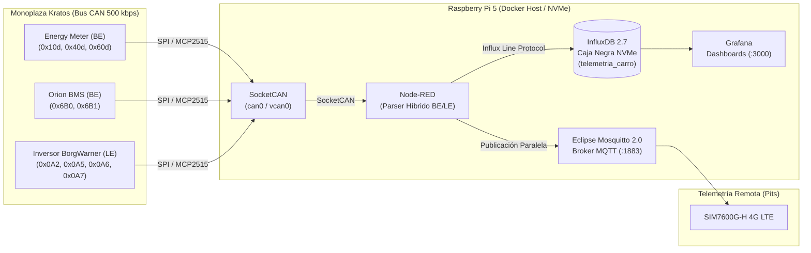

# Sistema de Telemetría y Adquisición de Datos — Kratos Formula SAE (Universidad EAFIT)

Plataforma de adquisición de datos en el borde (*Edge Computing*), almacenamiento en caja negra local y telemetría inalámbrica en tiempo real para el monoplaza eléctrico del equipo **Kratos Formula SAE — Universidad EAFIT**.

El sistema adquiere parámetros críticos del tren motriz eléctrico (**Orion BMS**, **Energy Meter FSAE** e **Inversor BorgWarner / Cascadia Motion**) a través del **bus CAN a $500\text{ kbps}$**, además de variables dinámicas del vehículo mediante sensores inerciales (**IMU GY-91**) y posicionamiento **GNSS/LTE 4G**.

---

## 1. Arquitectura de Hardware (Plataforma Raspberry Pi 5)

El sistema está diseñado sobre una arquitectura modular en Linux de 64 bits basada en **Raspberry Pi 5**:

| Subsistema | Componente / Referencia | Interfaz / Especificación Técnica |
| :--- | :--- | :--- |
| **Unidad Central (SBC)** | **Raspberry Pi 5 (4GB RAM)** | Linux 64-bit (Ubuntu / Raspberry Pi OS Bookworm) + Docker Engine |
| **Refrigeración y Chasis** | Caja disipadora de aluminio (`DISIPADOR-RPI5-2`) | Doble ventilador activo de 4 hilos (conector JST: `GND`, `+5V`, `TACH`, `PWM`) |
| **Almacenamiento (Caja Negra)** | Adaptador PCIe a M.2 (`WS-28013`) + SSD NVMe | Cinta FPC de 16 pines PCIe; alta resistencia a vibraciones mecánicas en pista |
| **Interfaz Bus CAN** | 2x Módulos `MCP2515` (`MCP2515CAN`) + `TJA1050` | Controlador SPI gestionado nativamente vía **SocketCAN** (`can0` a $500\text{ kbps}$) |
| **Adaptación de Nivel Lógico** | 2x Conversores Bidireccionales 8CH (`TXB0108` / `CONV-NIVEL-LOG-8CH`) | Traducción de niveles lógicos entre $3.3\text{ V}$ (GPIO RPi 5) y $5.0\text{ V}$ (`MCP2515`/`TJA1050`) |
| **Comunicaciones 4G LTE + GPS** | `SIM7600G-H 4G HAT (B)` (`WS-19485`) | LTE Cat-4 + GNSS conectado por USB; gestionado con `NetworkManager` / `ModemManager` |
| **Sensores Inerciales (IMU)** | Módulo `GY-91` (MPU-9250 + BMP280) | Acelerómetro, giroscopio, magnetómetro y barómetro a $3.3\text{ V}$ en bus I2C |

---

## 2. Conexionado Eléctrico y Pines GPIO (Raspberry Pi 5)

### 2.1 Interfaz CAN Bus (`MCP2515` + Conversor de Nivel Lógico `TXB0108`)
Dado que los pines GPIO de la Raspberry Pi 5 operan a **$3.3\text{ V}$** mientras que el transceptor CAN `TJA1050` requiere alimentación de **$5.0\text{ V}$**, todas las líneas digitales SPI e interrupción pasan a través del conversor bidireccional `TXB0108`:

* **Lado Bajo Voltaje (`VCCA` = $3.3\text{ V}$):** Conectado al riel de $3.3\text{ V}$ de la Raspberry Pi 5 (Pin 1) y `OE` habilitado a $3.3\text{ V}$.
* **Lado Alto Voltaje (`VCCB` = $5.0\text{ V}$):** Conectado al riel de $5.0\text{ V}$ de la Raspberry Pi 5 (Pin 2 o Pin 4) y alimentación `VCC` del módulo `MCP2515`.

| Señal SPI / CAN | Pin Físico RPi 5 | GPIO RPi 5 ($3.3\text{ V}$) | Canal `TXB0108` | Pin Módulo `MCP2515` ($5.0\text{ V}$) |
| :--- | :---: | :---: | :---: | :--- |
| **SPI0 MOSI** | Pin 19 | `GPIO10` | `A1 <-> B1` | `SI` (MOSI) |
| **SPI0 MISO** | Pin 21 | `GPIO9` | `A2 <-> B2` | `SO` (MISO) |
| **SPI0 SCLK** | Pin 23 | `GPIO11` | `A3 <-> B3` | `SCK` |
| **SPI0 CE0** | Pin 24 | `GPIO8` | `A4 <-> B4` | `CS` (Chip Select) |
| **CAN INT** | Pin 22 | `GPIO25` | `A5 <-> B5` | `INT` (Interrupción) |
| **Referencia** | Pin 6 / 9 / 20 | `GND` | `GND` | `GND` |

### 2.2 Sensor Inercial IMU `GY-91` (Conexión Directa a $3.3\text{ V}$)
El módulo `GY-91` opera nativamente a $3.3\text{ V}$ y se conecta directamente al bus **I2C1** de la Raspberry Pi 5:

| Señal I2C | Pin Físico RPi 5 | GPIO RPi 5 | Pin Módulo `GY-91` |
| :--- | :---: | :---: | :--- |
| **Alimentación $3.3\text{ V}$** | Pin 17 | `3V3 Power` | `VIN` / `3V3` |
| **I2C1 SDA (Datos)** | Pin 3 | `GPIO2 (SDA)` | `SDA` |
| **I2C1 SCL (Reloj)** | Pin 5 | `GPIO3 (SCL)` | `SCL` |
| **Referencia** | Pin 9 | `GND` | `GND` |

---

## 3. Arquitectura de Software Unificada

**Node-RED** actúa como motor central de adquisición desde **SocketCAN**, decodificación híbrida (**Big Endian / Little Endian**) y ruteo en paralelo en tiempo real:



### Características Clave del Sistema
1. **Ingesta Directa y Bifurcación en Paralelo:** Node-RED lee directamente de la interfaz de red del kernel (`can0` o `vcan0`), decodifica las tramas binarias en formato **Big Endian (Motorola)** y **Little Endian (Intel)** y bifurca cada muestra hacia dos salidas simultáneas:
   * **Salida 1 — Caja Negra Local (InfluxDB 2.7 sobre SSD NVMe):** Escritura directa mediante *Influx Line Protocol* con retención infinita (`0s`). Si el monoplaza pierde cobertura 4G LTE en pista o sufre un apagón súbito del sistema de baja tensión (GLV), los datos quedan resguardados localmente en los volúmenes persistentes sobre el disco NVMe.
   * **Salida 2 — Telemetría en Tiempo Real (Eclipse Mosquitto MQTT):** Publicación en tópicos jerárquicos ligeros para monitoreo en vivo desde los pits.
2. **Integración Nativa con SocketCAN:** Acceso directo a las interfaces `can0` y `vcan0` del sistema operativo Linux anfitrión.

---

## 4. Estructura del Repositorio

```text
Kratos-Telemetria-/
├── README.md                                       # Documentación general del proyecto
└── Kratos/
    ├── INFORME_TECNICO_ARQUITECTURA_SOFTWARE.md    # Informe técnico oficial para jueces FSAE y equipo
    ├── docker-compose.yml                          # Stack unificado (Mosquitto, Node-RED, InfluxDB, Grafana)
    ├── .env                                        # Variables de entorno centralizadas (credenciales, tokens, buckets)
    ├── mosquitto/
    │   └── config/
    │       └── mosquitto.conf                      # Configuración del broker MQTT
    ├── nodered/
    │   └── data/
    │       ├── package.json                        # Dependencias (node-red-contrib-socketcan, node-red-contrib-influxdb)
    │       └── flows.json                          # Flujo de lectura CAN, parseo BE/LE, Line Protocol y MQTT
    └── scripts/
        ├── setup_vcan.sh                           # Script para instalar can-utils y levantar vcan0 en Ubuntu
        ├── setup_can0_rpi5.sh                      # Script para levantar can0 físico a 500 kbps en la Raspberry Pi 5
        └── can_simulator.py                        # Emulador en Python (python-can) para Energy Meter, BMS e Inversor
```

---

## 5. Diccionario de Tramas CAN (Manuales Oficiales: Big Endian + Little Endian)

| ID CAN | Subsistema (`origen`) | Endianness | Mapa de Bytes (Manuales Oficiales) | Variables Decodificadas | Tópicos MQTT Publicados |
| :---: | :--- | :---: | :--- | :--- | :--- |
| `0x10d` | `energy_meter` | **Big Endian** | `0..3`: `float BE` (`Current [A]`!)<br>`4..7`: `float BE` (`Voltage [V]`) | `current` ($\text{A}$), `voltage` ($\text{V}$)<br>`power_kw` ($\text{kW}$) | `kratos/telemetria/energy_meter/0x10d`<br>`kratos/telemetria/energy_meter/corriente`<br>`kratos/telemetria/energy_meter/voltaje`<br>`kratos/telemetria/energy_meter/potencia_kw` |
| `0x40d` | `energy_meter` | **Big Endian** | `Byte 0 [0]`: `Violation`<br>`Byte 0 [1]`: `Logging`<br>`1..3`: Reservados<br>`4..7`: `float BE` (`Energy [Whr]`) | `violation` ($0/1$)<br>`logging` ($0/1$)<br>`energy_whr` ($\text{Whr}$) | `kratos/telemetria/energy_meter/0x40d`<br>`kratos/telemetria/energy_meter/energia` |
| `0x60d` | `energy_meter` | **Big Endian** | `Byte 0 [2:0]`: `mux_id` ($0$)<br>`Byte 0 [7:3]`: `num_sensors`<br>`Byte 1`: `Min Temp` ($0.5\text{ }^\circ\text{C}$)<br>`Byte 2`: `Max Temp` ($0.5\text{ }^\circ\text{C}$) | `min_temp` ($^\circ\text{C}$)<br>`max_temp` ($^\circ\text{C}$)<br>`num_sensors` | `kratos/telemetria/energy_meter/0x60d` |
| `0x6b0` | `orion_bms` | **Big Endian** | `0..1`: `int16 BE` ($0.1\text{ A}$)<br>`2..3`: `uint16 BE` ($0.1\text{ V}$)<br>`4`: `uint8` ($0.5\text{ \%}$)<br>`5`: `int8` ($T_{\max}$), `6`: `int8` ($T_{\min}$)<br>`7`: `uint8` (`Relay/Fault`) | `pack_current` ($\text{A}$)<br>`pack_voltage` ($\text{V}$)<br>`soc` ($\text{\%}$)<br>`temp_max`, `temp_min` ($^\circ\text{C}$) | `kratos/telemetria/bms/estado`<br>`kratos/telemetria/bms/0x6b0` |
| `0x6b1` | `orion_bms` | **Big Endian** | `0..1`: `uint16 BE` (`DCL [A]` )<br>`2..3`: `uint16 BE` (`CCL [A]` )<br>`4..5`: `uint16 BE` ($0.0001\text{ V}$)<br>`6..7`: `uint16 BE` ($0.0001\text{ V}$) | `pack_dcl` ($\text{A}$), `pack_ccl` ($\text{A}$)<br>`high_cell_voltage` ($\text{V}$)<br>`low_cell_voltage` ($\text{V}$) | `kratos/telemetria/bms/limites_celdas`<br>`kratos/telemetria/bms/0x6b1` |
| `0x0a2` | `inversor_borgwarner` | **Little Endian** | `0..1`: `int16 LE` ($0.1\text{ }^\circ\text{C}$)<br>`4..5`: `int16 LE` ($0.1\text{ }^\circ\text{C}$) | `inverter_temp` ($^\circ\text{C}$)<br>`motor_temp` ($^\circ\text{C}$) | `kratos/telemetria/inversor/temperaturas`<br>`kratos/telemetria/inversor/0x0a2` |
| `0x0a5` | `inversor_borgwarner` | **Little Endian** | `2..3`: `int16 LE` ($1\text{ RPM}$) | `motor_speed_rpm` ($\text{RPM}$) | `kratos/telemetria/inversor/velocidad_motor`<br>`kratos/telemetria/inversor/0x0a5` |
| `0x0a6` | `inversor_borgwarner` | **Little Endian** | `6..7`: `int16 LE` ($0.1\text{ A}$) | `dc_bus_current` ($\text{A}$) | `kratos/telemetria/inversor/corriente_dc`<br>`kratos/telemetria/inversor/0x0a6` |
| `0x0a7` | `inversor_borgwarner` | **Little Endian** | `0..1`: `int16 LE` ($0.1\text{ V}$) | `dc_bus_voltage` ($\text{V}$) | `kratos/telemetria/inversor/voltaje_dc`<br>`kratos/telemetria/inversor/0x0a7` |

---

## 6. Guía Paso a Paso de Ejecución y Pruebas en Ubuntu (Sin Hardware)

### Paso 1: Levantar la interfaz CAN virtual (`vcan0`)
```bash
cd Kratos
./scripts/setup_vcan.sh
```

### Paso 2: Levantar el stack unificado de contenedores Docker
```bash
docker compose up -d
```
> Nota: Para instalar las dependencias declaradas en `nodered/data/package.json` por primera vez:
> ```bash
> docker exec -it kratos-nodered npm install --prefix /data
> docker restart kratos-nodered
> ```

### Paso 3: Iniciar el simulador de tramas CAN (`can_simulator.py`)
```bash
pip install python-can
python3 ./scripts/can_simulator.py --interface vcan0 --freq 5
```

### Paso 4: Verificar los servicios y visualización
* **Node-RED (Flujo y Monitor Debug):** `http://localhost:1880`
* **InfluxDB 2.7 (Data Explorer — Bucket `telemetria_carro`):** `http://localhost:8086`
  * **Usuario:** `admin` | **Contraseña:** `kratos_influx_pass`
  * **Organización:** `kratos_fsae` | **Token:** `kratos-fsae-telemetry-token-2026`
* **Grafana (Dashboards):** `http://localhost:3000`
  * **Usuario:** `admin` | **Contraseña:** `kratos_grafana_pass`
* **Suscripción de prueba por consola a Mosquitto MQTT:**
  ```bash
  docker exec -it kratos-mosquitto mosquitto_sub -t "kratos/telemetria/#" -v
  ```

---

## 7. Despliegue en la Raspberry Pi 5 (Monoplaza)

1. Agrega las siguientes líneas en `/boot/firmware/config.txt` de la Raspberry Pi 5 y reinicia:
   ```ini
   dtparam=spi=on
   dtparam=i2c_arm=on
   dtoverlay=mcp2515-can0,oscillator=8000000,interrupt=25
   ```
2. Activa la interfaz física `can0` a $500\text{ kbps}$:
   ```bash
   ./Kratos/scripts/setup_can0_rpi5.sh can0 500000
   ```
3. En `Kratos/.env` (y en el nodo `socketcan-config` de Node-RED), configura `can0` y levanta el stack con `docker compose up -d`.
